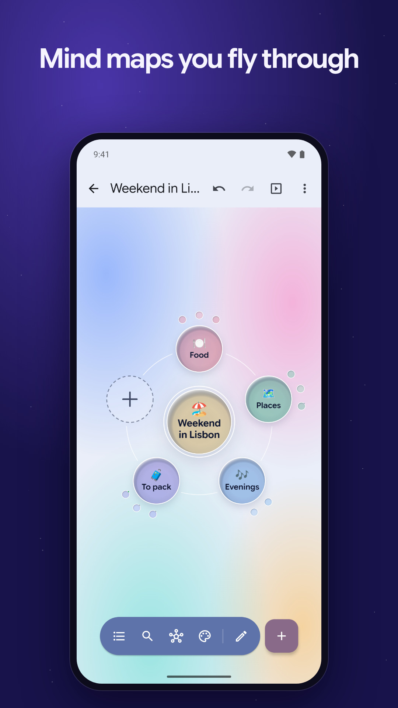
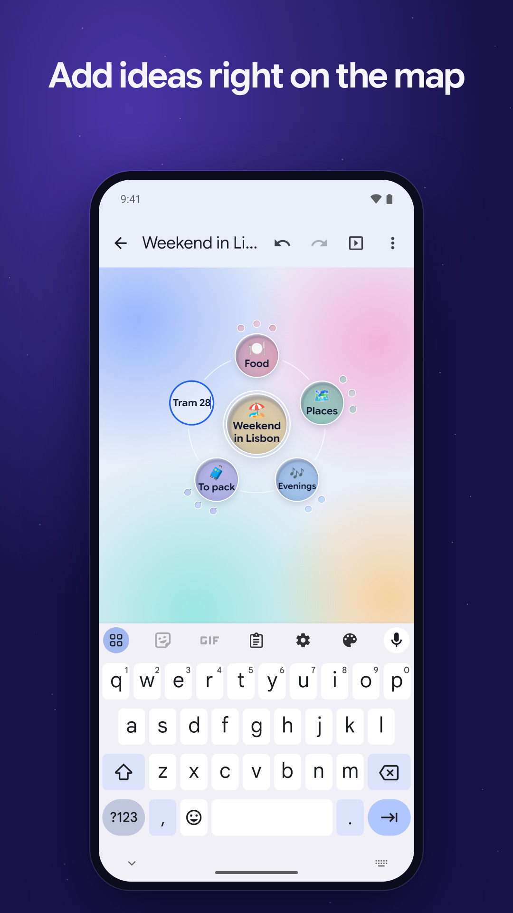
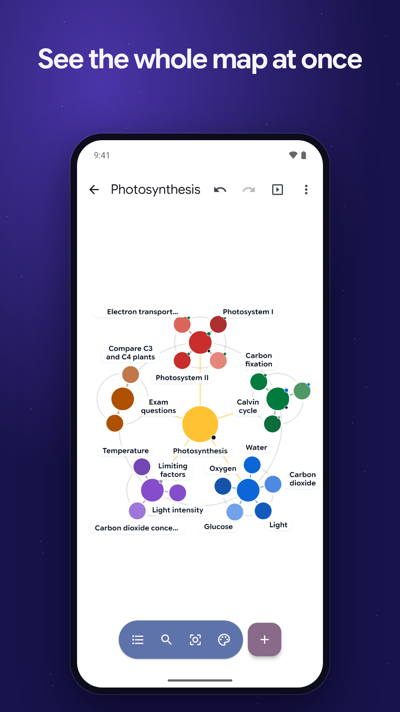
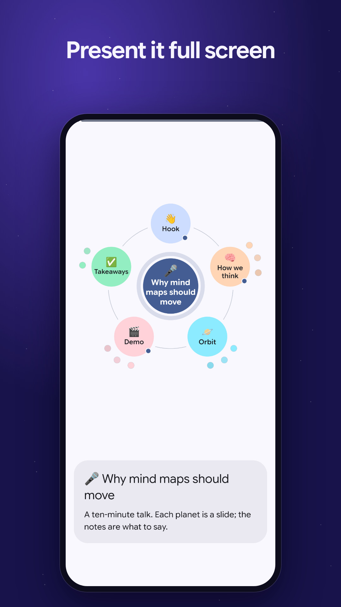

# Orbit for Android

**Your universe of ideas, in orbit.** Mind maps you fly through, on phones, tablets and Chromebooks: build a map right on the map, give each idea a color, a status, a note, a picture or a link, then present it on any screen.

<p>
  
  
  
  
</p>

**[orbit.hyuchia.com/android](https://orbit.hyuchia.com/android)** · [Every feature](docs/features.md) · [How it's built](docs/architecture.md) · [Privacy](app/src/main/assets/privacy.md) · [Contributing](CONTRIBUTING.md) · [Translating](TRANSLATING.md)

## Get it

Download the APK from [orbit.hyuchia.com/android](https://orbit.hyuchia.com/android) or this repository's [releases](https://github.com/restless-dreams/orbit-android/releases): it tells you when there's a new version. Coming soon to Google Play, F-Droid and AppGallery. Or build it yourself: see [Building](#building).

## What it does

- **Build on the map.** Tap the + in the orbit and type inside the new planet, or hold it and talk: each sentence becomes an idea.
- **Fly through it.** Tap a planet to fly in, spin the orbit, pinch to zoom, or see the whole map at once.
- **Ideas that hold more:** colors, statuses, notes, pictures, videos and links, to-dos, and goals with rings that fill as you go.
- **Present it anywhere:** full screen with captions, on a TV or a second screen, or in every browser in the room, along your own path and with rehearsed timings.
- **Between your devices:** send a map to a phone or tablet nearby, encrypted end to end, or keep every map as a markdown file in a folder you sync.
- **Phones, tablets and Chromebooks,** either way up, with a keyboard and a mouse too.
- **Your maps stay yours:** no account, no ads and no tracking. Maps are plain files on your phone, with versions, a trash and backups.
- **In English and Spanish.**

Every feature, area by area, is in [docs/features.md](docs/features.md).

## Building

You need JDK 21 (`mise install` reads `mise.toml`) and the Android SDK with platform and build tools 37. Then:

```bash
./gradlew assembleLibreDebug     # the build without Google code, for F-Droid, AppGallery and APKs
./gradlew assemblePlayDebug      # the Google Play build, which casts to TVs with Google Cast
```

The maps are drawn by [Orbit](https://github.com/restless-dreams/orbit), the web library, in WebViews. Its pages are built from `web/` and committed, so Gradle is all the build needs. [CONTRIBUTING.md](CONTRIBUTING.md) has the rest: the tests, the pages, the logo, the baseline profile and casting to TVs.

## License

Copyright © 2026 Diana Islas Ocampo.

Orbit for Android is free software: you can redistribute it and/or modify it under the terms of the [GNU General Public License](LICENSE) as published by the Free Software Foundation, either version 3 of the License, or (at your option) any later version. The `play` build links the Google Play services libraries, under the [additional permission](LICENSE-EXCEPTION.md) in section 7 of the license; the `libre` build has none of them.

The maps are drawn by [Orbit](https://orbit.hyuchia.com), under the MIT License, and the app's font is [Google Sans Flex](https://github.com/googlefonts/googlesans-flex), under the SIL Open Font License 1.1. The app lists every library it's built with, and their licenses, under Settings, About.
