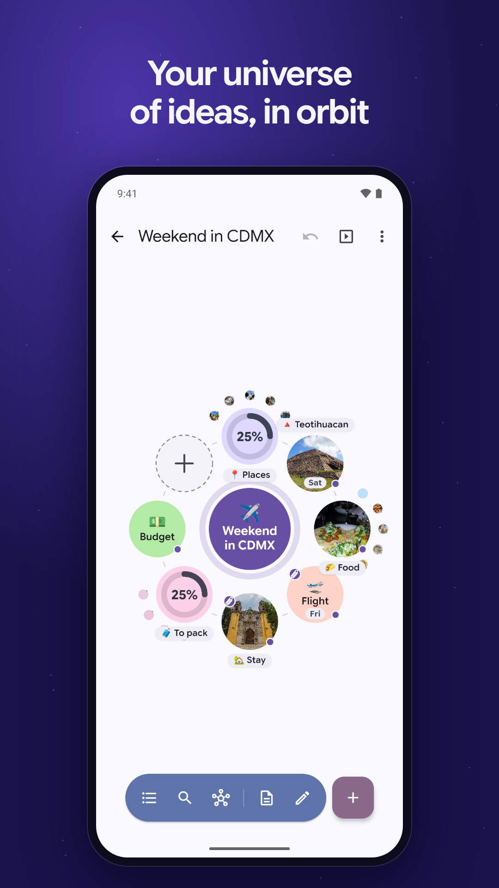
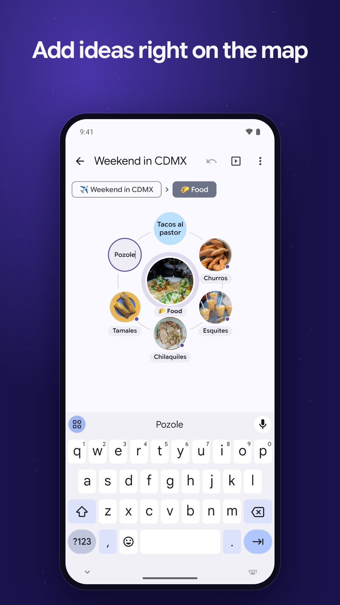
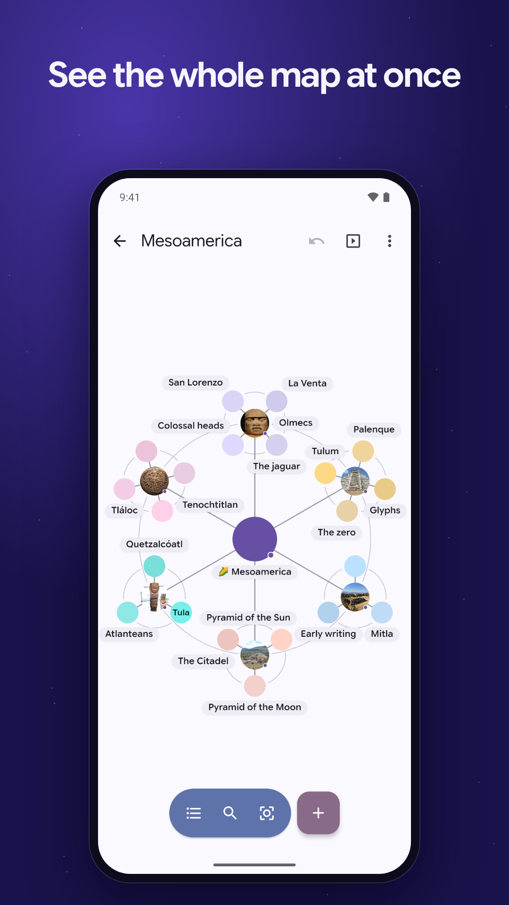
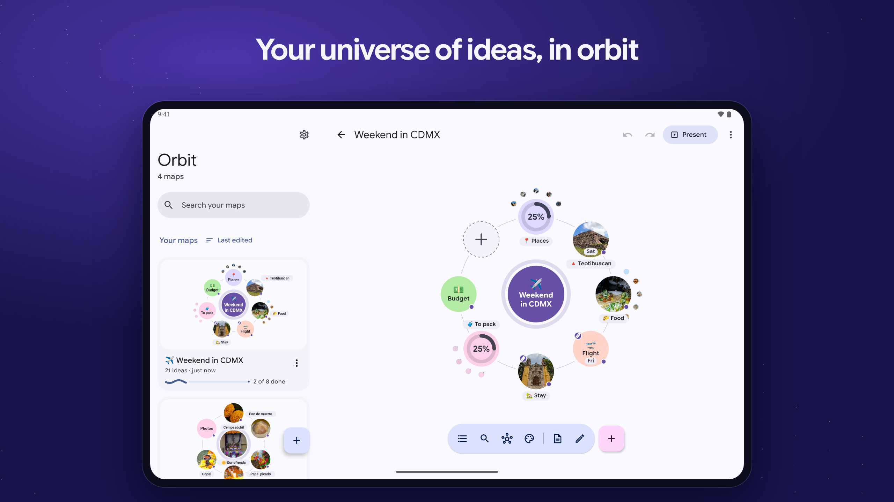

## Abstract for new app inclusion

### Please introduce the functions and usage of your app in summary, and also attach some screenshots.

Orbit turns your ideas into a mind map you fly through. Tap an idea and the map zooms in to show what's around it, flick an orbit to spin it, and zoom out to see everything at once. You build the map right on the map: ideas go around the one in the middle, typed inside their planets, and each can have a color, a status, a note, a picture, a voice memo or a link. You can present a map full screen, on a second screen, a TV or any browser in the room, study it as flashcards, keep it private behind your fingerprint, face or PIN, and send it to your other devices on the same Wi-Fi, encrypted end to end.

Every map is a plain markdown file on the phone, and Orbit can keep them in a folder of your choice, for Syncthing or anything else that syncs folders. No accounts, ads or tracking.

  

All the screenshots, phone and tablet: https://github.com/restless-dreams/orbit-android/tree/v0.4.0/fastlane/metadata/android/en-US/images

### Please elaborate why you wrote this app. Please highlight the unique functions it provides over other similar apps in F-Droid.

- **Maps you fly through.** Ideas are drawn as planets and moons around a sun, with camera flights between them, instead of a static tree. The maps are drawn by Orbit, our free (MIT) web library: https://github.com/restless-dreams/orbit
- **Plain files.** Each map is a markdown file that any text editor can open, and Orbit keeps your formatting when it saves. Every map keeps its versions, with when, why and what changed.
- **Study and keep private:** a map becomes flashcards whose ideas stay hidden until you reveal them, each coming back when it's due, and a private map stays locked behind the phone's own fingerprint, face or PIN prompt.
- **Pictures, sounds and voice:** pictures, live photos, GIFs, videos, sounds and voice memos on ideas, all kept beside the map's file.
- **Maps from other apps:** it opens OPML, FreeMind, Freeplane and XMind files, with their notes and pictures, and exports OPML, PDF or a print.
- **Presenting:** a presenter view on the phone, with the map on a second screen, a TV or in browsers in the room, served from the phone over Wi-Fi.
- **Phones, tablets and Chromebooks,** with keyboard and mouse support, in English and Spanish.

## Notes for reviewers

- **Flavors:** `gradle: [libre]`. The libre flavor has no Google Play services or other closed code (its open-source libraries include AndroidX and ZXing). The `play` flavor adds Google Cast for the Google Play build only (`playImplementation`, `src/play/`).
- **Reproducible builds:** the APK in `Binaries` is the libre build of the tagged commit, built from a fresh clone and signed with our key. Each GitHub release has it as `orbit-<version>-fdroid.apk`. It's a different file from the release's `orbit-<version>.apk`, which only the website and GitHub get, because that one looks for updates on GitHub.
  - We ran this recipe through `fdroid build` in `registry.gitlab.com/fdroid/fdroidserver:buildserver-trixie`, as the `fdroid build` CI job does, for 0.2.0 and 0.3.0, and F-Droid's build matched our signed APK each time.
- **The map's pages** (`app/src/main/assets/map/*.js`) are JavaScript built from `web/` with the Orbit library, at the commit recorded in `app/src/main/assets/map/orbit.json`, which is a commit of github.com/restless-dreams/orbit. The app's CI rebuilds them from source and fails if they differ from the committed files (`.github/workflows/ci.yml`, the "pages" job). If you'd rather F-Droid build them too, tell us how you'd like it set up.
- **Permissions** (the Reports tab flags the first two as minor):
  - `RECORD_AUDIO`: holding the + and talking turns what you say into ideas, through the phone's own speech service, and an idea can have a voice memo, recorded when you tap record and kept beside the map's file. Orbit asks for it the first time either is used. Without it, the + opens the new idea for typing instead.
  - `INTERNET`: the small server on the Wi-Fi that sends maps between your devices and shows a map in browsers in the room, and YouTube and Vimeo videos in maps. The F-Droid build never checks for updates.
  - `USE_BIOMETRIC`: private maps unlock with Android's own prompt, with the fingerprint, face or screen lock PIN. Orbit only learns whether it succeeded.
  - `ACCESS_NETWORK_STATE`, `FOREGROUND_SERVICE`, `WAKE_LOCK` and `RECEIVE_BOOT_COMPLETED` come from AndroidX WorkManager, which keeps the home screen widgets current.
- **Anti-features:** maps can hold YouTube and Vimeo videos, which play in those sites' own embedded players (YouTube's privacy-enhanced mode), and a YouTube video's thumbnail comes from img.youtube.com. Nothing in the app depends on them, so we haven't added NonFreeNet. Let us know if you think it applies.

## Checklist

### Policy

* [x] The app complies with the [inclusion criteria](https://f-droid.org/docs/Inclusion_Policy).
* [x] The original app author has been notified (and does not oppose the inclusion). If you are not the author, please paste the link of the reply from the author. I'm the author.
* [x] The upstream app source code repo contains the app metadata in a [Fastlane](https://gitlab.com/snippets/1895688) or [Triple-T](https://gitlab.com/snippets/1901490) folder structure. The summary and description must be included and images, icon, and changelog should also be provided for better user experience. The `en-US` locale must be included. Fastlane, in `en-US`, `es-419` and `es-ES`: title, summary, description, icon, feature graphic, phone and tablet screenshots, and changelogs.

### Docs

* [x] Please read [the guide](https://gitlab.com/fdroid/fdroiddata/-/blob/master/CONTRIBUTING.md) first if this is your first contribution.
* [x] Please make sure your metadata follows the best practice in [our templates](https://gitlab.com/fdroid/fdroiddata/tree/master/templates).
* [x] Please read the [Build Metadata Reference](https://f-droid.org/docs/Build_Metadata_Reference/) and make sure your metadata is valid.
* [x] Please read the [Quick Start Guide](https://f-droid.org/en/docs/Submitting_to_F-Droid_Quick_Start_Guide/).

### Merge Request Setup

* [x] The title of this merge request should follow "New app: app name" format.
* [x] Please make sure your fdroiddata fork is public and your branch is not protected. See <https://docs.gitlab.com/user/project/repository/branches/protected/>.
* [x] Please read [our Git guide](https://gitlab.com/fdroid/wiki/-/wikis/Tips-for-fdroiddata-contributors/Git-Usage) if you don't know how to rebase your branch. Don't rebase your branch if there is no conflict.
* [x] All related [fdroiddata](https://gitlab.com/fdroid/fdroiddata/issues) and [RFP issues](https://gitlab.com/fdroid/rfp/issues) have been referenced in this merge request. There are none: rfp#3706 ("Request to add Orbit") is a different app by another author, a game at github.com/ehcheng/orbit-android.
* [x] Please only submit one app in one MR.

### Metadata

* [x] Metadata must be put in `metadata/<applicationId>.yml`. It's `metadata/com.hyuchia.orbit.yml`.
* [x] Metadata must be a valid YAML file. `fdroid lint` is clean and `fdroid rewritemeta` changes nothing.
* [x] Metadata must use LF as line ending.
* [x] Don't add summary/description/changelog/images or anything that should be provided in upstream repo. Please check the Changes tab to make sure there is no other unrelated files added in the MR.
* [x] Releases are tagged and auto update is enabled unless there is a special reason. Tags are `v<version>` (now `v0.4.0`), with `UpdateCheckMode: Tags` and `AutoUpdateMode: Version`.
* [x] There is an issue tracker and contact info of the author so that we can report bugs and contact the author. https://github.com/restless-dreams/orbit-android/issues, and `AuthorEmail`.
* [x] An AuthorName must be added. It doesn't need to be the real name.
* [x] External repos are added as git submodules instead of srclibs. You can update git submodules without opening an MR in this repo and the submodule is covered by our scanner. None are needed: no submodules or srclibs.
* [x] Enable [Reproducible Builds](https://f-droid.org/docs/Reproducible_Builds). We'll use your signature for improved security/reliability, also allowing users to switch between different channels. Do note that if you don't enable reproducible build then the apk will be signed with our key so you can't enable it later. If you can't enable this, please add the reasons here. `Binaries` and `AllowedAPKSigningKeys` are set.
* [x] Setup abi split if the APK is large and the splitted ones can be much smaller. Not needed: the APK is about 10 MB, and its only native code is two small AndroidX libraries.
* [x] Only the latest versions should be kept in the metadata before it's merged. If you update the metadata, please replace the old versions with the new ones. Only 0.4.0.
* [x] Don't add any disabled versions in the metadata.
* [x] The `commit` field should be the full hash. Please don't use tag or branch in commit.

### Pipeline

* [ ] All pipelines should pass.
* [ ] All warnings and errors in the Reports tab should be fixed or explained.
* [x] F-Droid CI runners are under GitLab's FOSS program, so there's no need for you to pay for any CI time. If Gitlab starts asking for phone numbers or credit cards don't submit anything, just leave a note in the MR so we know we need to trigger the CI.

---------------------

/label ~"New App"
